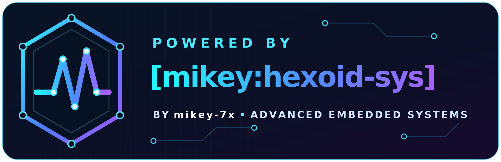
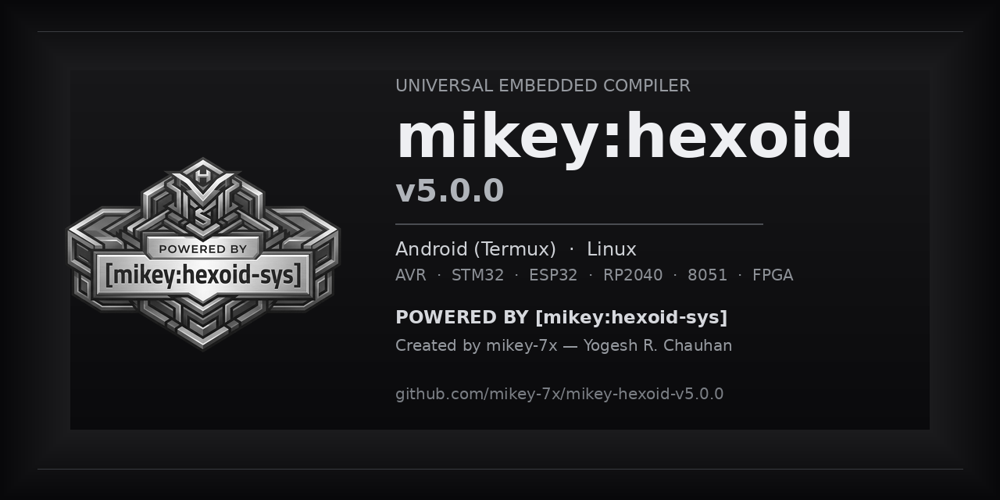

<div align="center">



# mikey:hexoid v5.0.0

**Universal embedded cross-compilation engine for Android (Termux) and Linux.**


`POWERED BY [mikey:hexoid-sys]`

</div>

---

## Overview

**mikey:hexoid** turns a phone or a Linux terminal into a working build station. One
installer prepares the toolchains, keeps board definitions and libraries in order, compiles
Arduino-style projects for the targets in its board table, and copies the resulting build
artefacts to shared storage so an on-device flashing app can pick them up.

A Verilog flow is bundled as well: designs for the iCE40 family are synthesised, placed,
routed and packed with the open-source IceStorm toolchain, with a schematic image and a
simulation waveform produced alongside the bitstream. 8051 and STM8 projects build through
SDCC.

Everything is driven from a numbered terminal menu — no IDE, no desktop session, no local
PC required.

## At a glance

| Item | Detail |
| --- | --- |
| Platform | Android (Termux) and Linux (Debian/Ubuntu, Arch, Void and other `apt`/`pacman`/`xbps` systems) |
| Implementation | Bash installer with an embedded Python engine (`~/mikey-hexoid/mhex.py`) |
| Selectable targets | 105 board entries; a few are aliases that share one board definition, and real availability depends on the cores actually installed |
| Compiler backends | Arduino CLI **0.35.3** (pinned), **SDCC** for 8051/STM8, **OSS CAD Suite** for FPGA |
| Output formats | Determined by target and toolchain — see [docs/OUTPUTS-AND-BOARDS.md](docs/OUTPUTS-AND-BOARDS.md) |
| Output location | `/storage/emulated/0/mikey-hexoid-outputs` on Android, `~/mikey-hexoid-outputs` on Linux |
| Licence | Strict personal & educational use, **non-commercial** — see [LICENSE](LICENSE) |
| Version | 5.0.0 |

## Project card

<div align="center">



<sub>Official project card. The same image is used as this repository's social preview when the link is shared.</sub>

</div>

## Two engines

| Script | What it adds |
| --- | --- |
| **`mhex.sh`** | The classic omniverse engine. Menus 1–7: smart project creation, universal compile, library manager, code editor, test blinks, pin reference and the operator manual. |
| **`mhex_e.sh`** | Everything above **plus** menu 8, an STM32 workflow with LL / HAL / plain-Arduino boilerplate, and the cross-distribution dependency fixes. Recommended for STM32 work. |

Both scripts share the same install root (`~/mikey-hexoid`) and the same output folder.

## Quick start

```bash
# enhanced engine (recommended)
git clone https://github.com/mikey-7x/mikey-hexoid-v5.0.0.git
cd mikey-hexoid-v5.0.0
chmod +x mhex_e.sh
./mhex_e.sh
```

```bash
# classic engine
git clone https://github.com/mikey-7x/mikey-hexoid-v5.0.0.git
cd mikey-hexoid-v5.0.0
chmod +x mhex.sh
./mhex.sh
```

The first run installs system packages, the FPGA tools (when `yosys` is missing), Arduino
CLI, the board cores and a set of common libraries. It can take a long time and needs a
working internet connection. When it finishes, the interactive menu opens.

Detailed guidance: **[docs/QUICKSTART.md](docs/QUICKSTART.md)**

## Menu reference

| Option | Action | Engine |
| --- | --- | --- |
| `1` | Create New Project (Smart) — picks a board and writes starter code | both |
| `2` | Compile Project (Universal) — choose project, then target board ID | both |
| `3` | Library Manager — search the index or install a ZIP from Downloads | both |
| `4` | Edit Project Code — opens `$EDITOR` (default `nano`) | both |
| `5` | Generate Test Blinks — fast and slow blink sketches | both |
| `6` | Pin Definitions (Quick) | both |
| `7` | Detailed Manual (Long) | both |
| `8` | STM32 Advanced (LL / HAL / Arduino) | `mhex_e.sh` |
| `0` | Exit | both |

A typical session is: `1` to create, `4` to edit, `2` to compile, then flash the file from
the output folder.

## What the installer prepares

- **System packages** resolved per package manager (`apt`, `pacman`, `xbps`, Termux `pkg`).
- **Arduino CLI 0.35.3** for the detected architecture, downloaded into `~/mikey-hexoid/bin`.
- **Board indexes and cores**: Arduino AVR, Arduino SAMD (not on `aarch64`), ESP8266, ESP32,
  RP2040, STM32duino, MiniCore, MightyCore, MegaCore, MicroCore, Adafruit AVR and SAMD,
  and Teensy. ATTinyCore and DxCore are cloned directly when they are missing.
- **Common libraries** — display, sensor, networking and motor helpers — installed once on
  first run.
- **The FPGA suite** (OSS CAD Suite) when `yosys` is not already available.

Nothing is installed outside `$HOME` except distribution packages, which use the system
package manager.

## Compiling a project

1. Put each sketch in its own folder under `~/mikey-hexoid/projects/` — a folder must be
   named like the `.ino` file inside it.
2. Run the engine and choose **2. Compile Project**.
3. Pick the project number, then the **board ID** from the printed table
   (for example `40` = BluePill F103C8).
4. The engine verifies that the board core is installed, adds a sensible `LED_BUILTIN`
   definition when the sketch has none, compiles, and copies the artefacts into
   `mikey-hexoid-outputs/<board name>/<project>/`.

If a build fails because a library or core is missing, the engine reads the compiler output,
offers to install what it identified, and retries once. It is a log-driven repair step, not
a general fix for broken source code.

## Output formats

| Target family | Typical files produced | Notes |
| --- | --- | --- |
| AVR (`arduino:avr`, MiniCore, MightyCore, MegaCore, MicroCore, ATTinyCore) | `.hex`, `.elf`, sometimes `.eep` | Flash with avrdude / USBasp-based tools |
| STM32 (STM32duino) | `.bin`, `.hex`, `.elf`, `.map` | Flash through ST-LINK with SWD |
| ESP8266 / ESP32 | `.bin` (plus `.elf`) | Size and partition settings come from the core |
| RP2040 | `.uf2` (plus `.elf`) | Copy the `.uf2` to the bootloader drive |
| Teensy / Adafruit SAMD | `.hex`, `.bin`, `.uf2` depending on core | Follow that core's uploader |
| 8051 / STM8 (SDCC) | `.hex` (from the SDCC `.ihx`) | Conversion is by file naming only |
| FPGA (board ID `999`) | `logic.json`, `logic.blif`, `netlist.v`, `circuit.png`, `.asc`, `.bin`, `.hex`, `waveform.vcd` | Each file appears only when the matching tool succeeds |

The engine copies the extensions the toolchain actually emits (`.bin`, `.hex`, `.uf2`,
`.elf`, `.map`, `.eep`). It does **not** convert one format into another, and no toolchain
guarantees every format for every board.

## Flashing the result on a phone

**STM32 boards — ZFlasher STM32 with an ST-LINK V2 over USB-OTG**

1. Connect ST-LINK V2 to the board: `SWDIO`, `SWCLK`, `GND`, and `3.3V` only if the board is
   not otherwise powered.
2. Plug the ST-LINK into the phone through an OTG adapter and open **ZFlasher STM32**.
3. Choose the `.bin` or `.hex` file from `mikey-hexoid-outputs`, select the ST-LINK
   connection, then tap **Go!**.

**AVR boards — ZFlasher AVR with a USBasp**

Choose the `.hex` file, confirm the chip and fuse settings, then flash.

Full step-by-step notes, wiring and safety points: **[docs/FLASHING.md](docs/FLASHING.md)**

## STM32 advanced workflow

Menu **8** in `mhex_e.sh` offers LL, HAL or plain-Arduino boilerplate for the STM32 targets
in the board table, and compiles existing STM32 projects with the same universal compile
step. Boilerplate pins (`PC13` for BluePill/BlackPill) are starting points — check them
against your own board before flashing.

A USB-HID profile is available for the BluePill by appending `,usb=HID` to the board ID 40
FQBN inside `~/mikey-hexoid/mhex.py`. Note that a reinstall regenerates that file and undoes
the edit. The exact procedure is in
**[docs/STM32-WORKFLOW.md](docs/STM32-WORKFLOW.md)**.

## FPGA workflow

Board ID `999` runs the iCE40 flow: Yosys synthesis, a Graphviz schematic, nextPNR
place-and-route, IceStorm packing, and an Icarus Verilog simulation waveform. If `top.v`
does not exist, a small LED-counter example is created first.

Details and output meanings: **[docs/FPGA-WORKFLOW.md](docs/FPGA-WORKFLOW.md)**

## Requirements

| Requirement | Notes |
| --- | --- |
| Android with Termux, or a Linux distribution | Root is not required, but the installer calls `sudo` for system packages |
| ~3–6 GB free storage | Toolchains for several architectures are large |
| Internet access on first run | Package mirrors, board indexes, cores and libraries |
| `bash`, `python3`, `git`, `curl`/`wget` | Detected and installed by the script |

## Repository layout

```text
mikey-hexoid-v5.0.0/
├── mhex.sh                  # classic engine installer
├── mhex_e.sh                # enhanced engine installer (adds menu 8)
├── mhex.png                 # original project artwork
├── LICENSE                  # strict personal & educational use licence
├── NOTICE.md                # attribution requirements
├── AUTHORS.md               # author identity and official links
├── CHANGELOG.md             # release history
├── CONTRIBUTING.md          # how to report issues and contribute
├── SECURITY.md              # security and safe-use guidance
├── SUPPORT.md               # where to ask for help
├── CITATION.cff             # citation metadata
├── assets/                  # logo files, social preview and checksums
├── docs/                    # quick start, usage, outputs, flashing, limitations
├── tools/verify_repository.py
└── .github/                 # CI checks, issue and pull-request templates
```

## Verification

The repository ships a self-check that runs offline:

```bash
python3 tools/verify_repository.py
```

It confirms the expected file set, the exact `POWERED BY [mikey:hexoid-sys]` credit, licence
terms, script syntax, that the embedded Python engine still parses, and the checksums of the
brand assets. The same check runs in GitHub Actions on every push and pull request.

## Known limitations

- Some board IDs do not build with the current cores — **79**, **91**, **92**, **15** and
  **16–20** are the known cases.
- Entries **34**, **37** and **38** reuse the generic ESP32-C3 / S3 definitions, so board
  variants may need a corrected FQBN.
- Board `40` compiles without the USB-HID profile unless it is patched.
- The FPGA flow targets generic iCE40 parts with a fixed top-level template.
- No GUI: everything is a terminal menu.

The full list, with causes and workarounds, is in
**[docs/KNOWN-LIMITATIONS.md](docs/KNOWN-LIMITATIONS.md)**.

## Credits and acknowledgements

**Created by mikey-7x — Yogesh R. Chauhan**
(also known as Chauhan Yogeshkumar R.; online pseudonyms “mikey-7x” and “mikey”).

This engine is orchestration around excellent third-party software. Thanks are due to the
Arduino CLI and board-core maintainers, STMicroelectronics STM32duino, Espressif
(ESP8266/ESP32), Raspberry Pi (RP2040), PJRC (Teensy), SpenceKonde (ATTinyCore, DxCore),
MCUdude (MiniCore, MightyCore, MegaCore, MicroCore), Adafruit (cores and libraries), the
SDCC developers, YosysHQ (Yosys, nextPNR, IceStorm), Icarus Verilog, Graphviz, and the
maintainers of ZFlasher for on-device flashing.

Project artwork, the `POWERED BY [mikey:hexoid-sys]` identity and all original code,
scripts and documentation are © 2026 Yogesh R. Chauhan (mikey-7x).

## Licence

Released under the **mikey-7x Strict Personal & Educational Use Licence** — a
source-available, non-commercial licence. Personal, hobbyist and educational use is
welcome. Selling the tool or its outputs, bundling it into paid products, and industrial or
business use are prohibited without a separate signed written licence.

Read **[LICENSE](LICENSE)** and **[NOTICE.md](NOTICE.md)** before redistributing.
Commercial licensing enquiries: contact the author through the GitHub profile or the
repository's commercial-licence issue form.

---

<div align="center">


**Created by mikey-7x — Yogesh R. Chauhan**

**`POWERED BY [mikey:hexoid-sys]`**

Copyright © 2026 Yogesh R. Chauhan (mikey-7x). All rights reserved.

[Profile](https://github.com/mikey-7x) ·
[All repositories](https://github.com/mikey-7x?tab=repositories) ·
[This project](https://github.com/mikey-7x/mikey-hexoid-v5.0.0) ·
[YouTube](https://youtube.com/@mikey-7x) ·
[Blog](https://rtod-yv8.blogspot.com/?m=1)

<sub>Non-commercial licence. Not affiliated with or endorsed by any vendor named above.</sub>

</div>

<details>
<summary>Original project artwork</summary>


</details>
